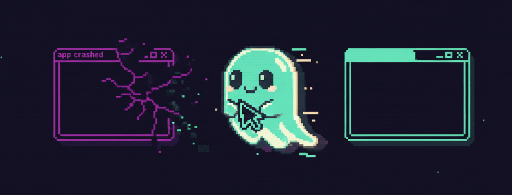
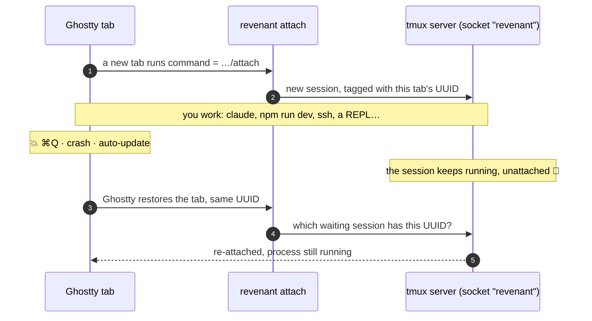

<p align="center">
  
</p>

<h1 align="center">revenant 👻</h1>

<p align="center">
  <b>Persistent sessions for Ghostty on macOS.</b><br>
  Quit Ghostty, crash it, let it auto-update: every tab comes back <i>with its process still running</i>.<br>
  Claude Code, dev servers, ssh, REPLs. No tmux knowledge needed.
</p>

<p align="center">
  
  
  
  
  
  
  <a href="https://github.com/zerotool/revenant/actions/workflows/test.yml"></a>
</p>

You have six tabs open. Claude Code is forty minutes into a refactor. `npm run dev` is warm, an ssh session is
mid-deploy, and a REPL holds state you would hate to rebuild. Then Ghostty auto-updates. Or crashes. Or you hit
**⌘Q** where you meant **⌘W**.

Ghostty brings your tabs back: windows, splits, directories. It does not bring back **what was running in
them**. Every one of those processes is dead.

**revenant** fixes that. Every Ghostty tab runs inside its own invisible tmux session, Ghostty can die as often as
it likes, and when it restores a tab, revenant hands that tab back exactly the session it had.

<p align="center">
  
</p>

## Install

```sh
brew install zerotool/tap/revenant
revenant install
```

<details>
<summary>Without Homebrew</summary>

```sh
brew install tmux        # or MacPorts / Nix, anything that puts tmux 3.3+ on disk
git clone https://github.com/zerotool/revenant ~/.revenant
~/.revenant/revenant install
```

</details>

Open a new Ghostty tab. That's it. Now try the trick: run `top`, quit Ghostty with **⌘Q**, open it again.
`top` never stopped.

`install` adds a marked block to your Ghostty config and one line to your shell profile, backs up both first,
and (for a git checkout) links the `revenant` CLI into `~/.local/bin`. Run it twice, nothing doubles; `revenant uninstall` takes it
all back out. Not sure? `revenant install --dry-run` shows the diff and writes nothing.

> [!NOTE]
> The first restored tab may make macOS ask whether Ghostty may control Ghostty. Say yes: that is how a tab
> asks "which tab am I?" and finds its session again.

**Needs:** macOS · Ghostty 1.4+ (tested on 1.4.0) · tmux 3.3+ (tested on 3.8) · zsh or bash.
**Update:** `brew upgrade revenant`, or `git -C ~/.revenant pull`. Nothing to reinstall either way.

## Who it's for

- **You run AI coding agents** (Claude Code, Codex, Aider) on jobs that take longer than your attention span.
- **You keep long-lived things in tabs**: dev servers, watchers, ssh sessions, REPLs, 40-minute builds.
- **You'd rather not learn tmux**, or you know it and don't want it in your face. You'll never press a tmux key.
- **You don't need it** if you already live inside tmux, zellij or [herdr](https://github.com/herdrdev/herdr), or you're on
  Linux (see the FAQ).

## The CLI

```console
$ revenant

  ┬─┐┌─┐┬  ┬┌─┐┌┐┌┌─┐┌┐┌┌┬┐
  ├┬┘├┤ └┐┌┘├┤ │││├─┤│││ │
  ┴└─└─┘ └┘ └─┘┘└┘┴ ┴┘└┘ ┴   Ghostty tabs that come back from the dead 👻

  revenant install [--dry-run]   point Ghostty and your shell at revenant (backs up what it edits)
  revenant uninstall             undo install; sessions that are running keep running
  revenant doctor                check the setup, one line per check
  revenant status                the sessions behind your tabs, and the ghosts waiting for theirs
```

```console
$ revenant status
👻 revenant · socket 'revenant'

     STATE    ID     RUNNING        WHERE
  🟢 tab      $0     claude         ~/code/shop
  🟢 tab      $1     node           ~/code/shop/web
  🟢 tab      $2     ssh            ~
  👻 ghost    $4     python3        ~/notebooks

    🟢 tab      attached to an open Ghostty tab
    💤 closing  its tab was closed; it ends within 15s, like a plain tab would
    👻 ghost    its Ghostty is gone; the restored tab takes it back, or it is cleaned up
                120s after Ghostty starts. End one now: tmux -L revenant kill-session -t <ID>
```

```console
$ revenant doctor
👻 revenant doctor
  ✓ macOS 15.5
  ✓ Ghostty 1.4.0 (/Applications/Ghostty.app/Contents/MacOS/ghostty)
  ✓ tmux 3.8 (/opt/homebrew/bin/tmux)
  ✓ Ghostty runs revenant for every tab
  ✓ Ghostty restores tabs (window-save-state = always)
  ✓ zsh integration loaded from ~/.zshrc
  ✓ server 'revenant' is up: 4 sessions, 1 of them ghosts waiting for their tab
  All good. Your tabs are haunted. 👻
```

| Command | Does |
| --- | --- |
| `revenant install [--dry-run]` | wires Ghostty and your shell up, backing up what it touches |
| `revenant status` | the sessions behind your tabs, and the ghosts waiting for theirs |
| `revenant doctor` | checks the whole chain, one line per link |
| `revenant uninstall` | removes what `install` added; running sessions keep running |

## How it works



```
  Ghostty tab ── tmux client ──╮
  Ghostty tab ── tmux client ──┼──▶  tmux -L revenant  ──▶  claude · npm run dev · ssh · …
  Ghostty tab ── tmux client ──╯     (no status bar, no prefix key, its own config)

  ⌘Q / crash / update: the clients die. The server and everything under it don't.
```

- **Tagging.** Ghostty runs `libexec/attach` instead of your shell for every tab and split. It starts a session
  on a private tmux server and tags it with the tab's surface UUID (asked from Ghostty over AppleScript) and with
  the Ghostty that owns it, by pid **and** start time, so a recycled pid never passes for a dead Ghostty.
- **Coming back.** With `window-save-state = always`, Ghostty restores tabs under their old UUIDs. A restored tab
  finds the waiting session with its UUID and attaches to it. A brand-new tab never adopts a leftover: no
  surprise shells.
- **Closing for real.** Close a tab on purpose and its session ends 15 s later, like a plain tab. The wait is how
  revenant tells a deliberate close from a crash: if Ghostty is gone by then, the session waits instead.
- **Cleaning up.** Ghosts nobody claims (a tab closed right before a quit, a window you didn't restore) are
  swept away once Ghostty has been up for 2 minutes.

## tmux, but you'll never see it

| You'd expect tmux to… | revenant's tmux… |
| --- | --- |
| show a status bar | has none |
| grab Ctrl-B | has no prefix key at all (`set -g prefix None`) |
| read your `~/.tmux.conf`, mix with your sessions | runs its own config on its own socket |
| break scrolling | scrolls back on the mouse wheel; any key drops you back at the prompt |
| swallow escape sequences | passes them through: Claude Code notifications and Shift+Enter, focus events, true color, hyperlinks, OSC 52 clipboard |
| break tab titles and "new tab in the same directory" | the zsh/bash integration reports cwd, titles and command start/finish, so Ghostty's `notify-on-command-finish` still fires |

## Configuration

Defaults are fine. If not, set any of these with Ghostty's `env` option (Ghostty 1.2+) in its config, for
example `env = REVENANT_REAP_DELAY=30`. The revenant server reads them when it starts, so they apply once
every tab has been closed (or after `tmux -L revenant kill-server`).

| Variable | Default | Meaning |
| --- | --- | --- |
| `REVENANT_REAP_DELAY` | `15` | seconds before a deliberately closed tab's session ends |
| `REVENANT_RESTORE_WINDOW` | `120` | seconds after Ghostty starts before unclaimed ghosts are swept |
| `REVENANT_SOCKET` | `revenant` | tmux socket name (`tmux -L <name>`) |
| `REVENANT_TMUX` | auto | path to tmux, when it is not where Homebrew, MacPorts or Nix put it |

## Prior art, and why this exists

Persistence itself is solved: tmux, [zmx](https://github.com/neurosnap/zmx), shpool and abduco all keep processes
alive. The missing piece is the glue between those sessions and Ghostty's restored tabs.

| Option | What you get | What's missing |
| --- | --- | --- |
| Ghostty's `window-save-state` | tabs, splits and directories come back | the processes in them |
| `command = tmux new -A -s main` | survives a quit | every tab mirrors the same shell |
| One named tmux session per project | survives, and stays separate | after a restart you `tmux a -t …` in every tab, by hand |
| [zmx](https://github.com/neurosnap/zmx), shpool, abduco | lightweight persistent sessions | you name and attach them yourself |
| [herdr](https://github.com/herdrdev/herdr) | a whole workspace for coding agents: its own panes, agent status, remote machines, sessions that outlive the client | you work in herdr's panes instead of Ghostty's own tabs and splits |
| [ghostmux](https://kaosmaps.github.io/ghostmux/) | a lovely invisible-tmux config | tabs aren't matched back to sessions |
| Ghostty's own [session manager](https://github.com/ghostty-org/ghostty/discussions/3358) | the real fix, some day | not shipped yet |

When Ghostty ships native session persistence, revenant can retire with honor. Until then: 👻.

## FAQ

**Does Ghostty keep my processes running after I quit it?**
No. With `window-save-state` it restores windows, tabs, splits and directories, but the programs that were
running in them are killed. revenant keeps them alive and puts each one back in its tab.

**How do I keep Claude Code (or Codex, or a dev server) running when Ghostty quits or crashes?**
Install revenant. The agent keeps working in its own tmux session while Ghostty is gone; reopen Ghostty and the
tab picks it up mid-sentence.

**Is this just tmux?**
Yes, in an invisibility cloak. If you already live inside tmux, you don't need revenant.

**Do I have to learn tmux?**
No. The prefix key is literally `None`.

**What happens when I close a tab on purpose?**
It dies like a normal tab, 15 seconds later.

**And splits?**
Each split is its own session and comes back to its own spot.

**What about scrollback?**
tmux keeps 50 000 lines per tab. Scroll with the wheel; any key returns you to the prompt.

**Why not Ghostty's native scrollback, like ghostmux does?**
Turning off tmux's alternate screen hands scrolling back to Ghostty, which is lovely for plain shell output.
It also breaks scrolling in live full-screen apps (ghostmux says so itself: Claude Code, vim, lazygit), and
those are exactly what revenant exists to keep alive. tmux's scrollback works for both.

**fish? nushell?**
Tabs survive in any shell. Titles and "new tab here" need a small integration script, and only zsh and bash have
one so far: `shell/revenant.<shell>`, PRs welcome.

**Linux?**
Not yet. Matching a tab to its session relies on Ghostty's macOS AppleScript API.

**How do I get rid of a ghost?**
`revenant status`, then `tmux -L revenant kill-session -t '$4'`. Or wait two minutes.

**Why "revenant"?**
A revenant is someone who comes back from the dead. Like your tabs.

## Uninstall

```sh
revenant uninstall    # removes the config block, the profile line and the CLI link
```

Sessions that are already running keep running until you close them. To end every one of them right now:
`tmux -L revenant kill-server`.

## Development

`test/smoke.sh` lints everything with bash 3.2 and shellcheck, runs an install/uninstall round trip against
throwaway files, and checks the reaper on a throwaway tmux server. It never touches your real setup, and CI runs
it on macOS for every push.

---

<sub>MIT · Pixel art generated with Google's Nano Banana · Built with a lot of help from Claude Code, which is
fitting: it is the reason this exists.</sub>
